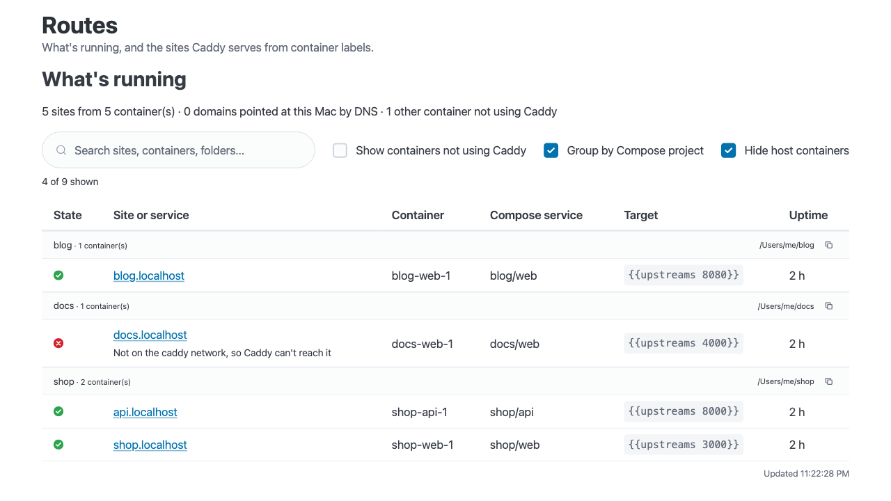
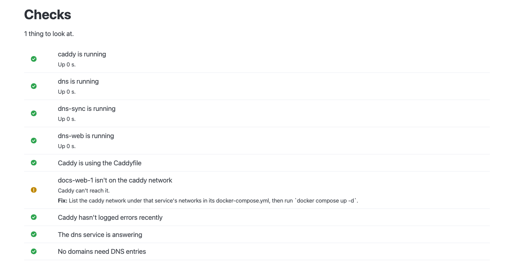

# Caddy reverse proxy (local dev)

Give your local Docker web apps custom domains and locally trusted HTTPS,
without publishing a separate host port for each app. Caddy routes requests to
each app's HTTP endpoint over a shared Docker network and handles TLS for you.

Open `https://shop.localhost` instead of remembering `http://localhost:3000`.
Your app only needs to listen on its container port; no `ports:` mapping or
`expose:` entry is needed. `.localhost` names work without DNS setup, and this
tool configures local DNS automatically for other custom domains on your Mac.

## Set up

1. Install and open Docker Desktop, then install `just`: `brew install just`.
2. Clone or download this repository, then start it from your checkout:

	```sh
	cd /path/to/caddy-local
	just up
	```

3. Enter your Mac password when asked, and answer `y` to trust the local certificate.
4. Open https://resolver.localhost. If you see the Routes page, it's working.

## Daily use

Merge this into your project's `compose.yml`, replacing `app` and `3000` with your service and its port inside the container:

```yaml
services:
  app:
    labels:
      caddy: app.localhost
      caddy.reverse_proxy: "{{upstreams 3000}}"
    networks: [caddy]
networks:
  caddy:
    external: true
```

Start your project. Open https://app.localhost; see all sites at https://resolver.localhost.
Keep both labels: a site name without a directive can break every site.



Example projects with synthetic data; `docs.localhost` shows a container missing the shared network.

Something not opening? Click **Run checks** on https://resolver.localhost, or run `just doctor` if that page won't load.

From this repo: `just up` starts, `just down` stops, `just ps` shows status, and `just logs` follows logs.

---

## Reference

You don't need any of this for everyday use.

### How it works

- Caddy uses [caddy-docker-proxy](https://github.com/lucaslorentz/caddy-docker-proxy)
	to watch the Docker socket and turn container labels into configuration.
	Containers from any Compose project can join the shared external `caddy`
	network so Caddy can reach them.
- `Caddyfile` enables `local_certs`: certificates come from Caddy's internal
	certificate authority (CA), without contacting a public ACME server or DNS
	provider. `just trust` adds the root CA to the macOS system keychain.
- Caddy state, including the CA, persists in `./caddy_data`.
- The `dns` service runs dnsmasq, answering address queries with `127.0.0.1`
	and `::1`. `dns-sync` watches Docker and writes a file in `/etc/resolver`
	for each eligible domain in a site label. macOS sends those domains to this
	service and keeps using normal DNS for everything else.
- `dns-web` serves the [routes page](#routes-page), with service status, instructions
	for adding a site and the checks. All three DNS services use the same image;
	`just up` builds `./dns` locally by default. With `DNS_IMAGE` configured, it
	tries pulling that image and builds locally if pulling fails.

Docker Desktop supplies `/var/run/docker.sock`; another runtime must expose
that socket and support the macOS bind mounts used here. Ports `80` (TCP) and
`443` (TCP and UDP) must be free. DNS binds to `127.0.0.1:5300` (TCP and UDP);
set `DNS_PORT` to change the host port. `RESOLVER_DIR` defaults to
`/private/etc/resolver`, the same directory as `/etc/resolver` on macOS.

### Exposing a container

Put labels on the service itself and connect it to the external `caddy`
network. This complete example serves an existing Node app on port `3000` at
https://app.localhost:

```yaml
services:
  app:
    image: node:20-alpine
    command: sh -c "npm install && npm run dev"
    working_dir: /app
    volumes:
      - ./:/app
    labels:
      caddy: app.localhost
      caddy.reverse_proxy: "{{upstreams 3000}}"
    networks:
      - caddy

networks:
  caddy:
    external: true
```

The app must listen on its container network interface, and `{{upstreams 3000}}`
means port `3000` at the container's address on the `caddy` network, so use the
port the app listens on inside the container, not a published one.

- Every site needs at least one directive, such as `caddy.reverse_proxy` or
	`caddy.respond: "hello"`; see [Troubleshooting](#troubleshooting).
- One `caddy` label can list several comma-separated addresses. For separate
	sites on one container, use numbered labels (`caddy_0`, `caddy_1`, ...), each
	with its own directives, such as `caddy_1.reverse_proxy`.
- A service with a `networks:` list joins only those networks, so if it also
	talks to other services in its project, list `default` there as well.

### DNS

`*.localhost` names resolve to localhost without changing `/etc/hosts` or
creating resolver files. For other domains, `dns-sync` reads `caddy` and
numbered `caddy_N` labels from running containers. For example:

```yaml
labels:
  caddy: ridiculous.com
  caddy.reverse_proxy: "{{upstreams 3000}}"
```

This serves https://ridiculous.com with a local certificate, subject to the
limits below.

- The first `just up` asks for your Mac password to create `/etc/resolver`
	owned by you. If it already exists and isn't writable, the recipe lists its
	contents and asks before taking ownership. If you decline, automatic DNS
	cannot write there. Once writable, DNS updates need no further password;
	trusting certificates can still require one.
- A resolver file claims the domain and all its subdomains, shadowing the real
	site while the container runs. It is removed when the container stops.
	Paused and restarting containers still count, as they do for Caddy.
- Schemes, ports, wildcards (`*.example.com` claims `example.com`), whitespace-
	or comma-separated lists, and internationalised names (converted to
	punycode) are handled. IP addresses, single-label names, `*.localhost`,
	`{{placeholders}}` and invalid hostnames are ignored. Single-label names
	would claim an entire top-level domain.
- `*.arpa` and `*.local` are refused to protect reverse lookups and local
	network discovery. Shared suffixes such as `co.uk` and `github.io` are also
	refused because claiming them would redirect unrelated sites Mac-wide.
	Names beneath shared suffixes, such as `app.github.io`, are allowed.
	`DENIED_SUFFIXES` and `DENIED_NAMES` in `dns/sync_resolvers.py` contain the
	short lists; this is not a full public-suffix list, so choose labels carefully.
- Caddy still serves ignored and refused names; they just don't get a resolver
	file.
- `dns-sync` marks its files with a `# managed by caddy-local` first line and
	never modifies resolver files without it, or symlinks or directories.
- Only apps using the macOS system resolver see these settings. `dig` and
	`nslookup` bypass them. Check with
	`dscacheutil -q host -a name ridiculous.com` or `curl https://ridiculous.com`.
- Containers use Docker's DNS, rather than this service.
- Clean shutdown removes managed resolver files. If Docker becomes
	unreachable, `dns-sync` keeps existing files. An unclean shutdown can leave
	them pointing at a stopped server; the next `just up` reconciles them, or
	`just dns-clear` removes them immediately.

### Routes page

https://resolver.localhost shows:

- **What's running**: one table with a row for every running container. It
	updates by itself every few seconds, so there is no need to reload.
	- **State**: hover the icon for the reason. A green tick means a Caddy site
		(or one of this setup's own services) is running and Caddy can reach it. A
		red cross means it is stopped, restarting, unhealthy, or (for a site) not on
		the `caddy` network, with the reason underneath. A grey dash means the
		container doesn't use Caddy, so this tool doesn't check it. Untick **Show
		containers not using Caddy** to hide those rows.
	- **Container**: hover the name to see the Compose project's folder on your
		Mac. The tooltip stays open while you move onto it, with a **Copy path**
		button, and clicking the name copies the folder too. Containers not started
		by Docker Compose have no folder to show.
	- **Search and sort**: the search box matches any column, including the folder
		and the reason. Click a column heading to sort, again to reverse, and a
		third time to go back to the default order. Your search and sort are kept as
		the table updates.
	- Each row also shows the Compose service, the `reverse_proxy` target and how
		long the container has been up. Wildcards are shown without links; IP
		addresses, placeholders and invalid site addresses are omitted. The table
		reads labels and Docker state only, so it does not confirm that Caddy
		accepted a route. The counts above it cover sites, domains pointed at this
		Mac, and containers not using Caddy.
- **Add a site**: enter a hostname and container port to update the snippet,
	then copy it into another project's `docker-compose.yml`. Use the port the app
	listens on inside the container; no `ports:` mapping or `expose:` entry is needed.
	Copy buttons cover the snippet and the command to restart that project.
- **Run checks**: see below.

#### Checks

**Run checks** (or `just doctor` in a terminal) looks for the usual problems and
says how to fix each one:

- a service that is stopped, or keeps restarting;
- Caddy not loading the `Caddyfile` (so real domains try a public certificate);
- a site label with no directive, which can stop every site;
- a container that is not on the `caddy` network, or two containers claiming
	one address;
- nothing listening on the port named in `{{upstreams PORT}}` (a 502);
- recent errors in Caddy's log, with a hint for the common ones;
- the `dns` service not answering, and domains missing or left over in
	`/etc/resolver`.



The page also tries to open each `https` site from your browser, which is the
only way to see the Mac's own DNS and certificate trust. A site that fails there
usually needs `just flush-dns` (stale DNS cache) or `just trust` (certificate).
A web page cannot clear the Mac's DNS cache itself, because that needs your
password on the Mac, so the page shows the command with a copy button.

Because Caddy serves the page, it disappears when the configuration is broken,
which is when you most need it. `just doctor` runs the same checks inside the
`dns-web` container and works either way. It cannot do the browser test.

### Commands

Run these from this repo. [just](https://github.com/casey/just) with no arguments
lists available recipes.

| Command | What it does |
| --- | --- |
| `just` / `just default` | List recipes. |
| `just up` | Create the network, prepare DNS and the DNS image, start all services and offer to trust the CA. |
| `just down` | Stop all services and remove managed resolver files, even if Docker cannot be reached. |
| `just restart` | Run `down` then `up`, picking up `Caddyfile` changes. |
| `just ps` | Show container status. |
| `just logs` | Follow all logs; `just logs dns-sync` follows one service. Multiple service names are accepted. |
| `just show-caddyfile` | Print the configuration generated from container labels. |
| `just doctor` | Run the checks from the terminal; works when the routes page is down. |
| `just flush-dns` | Clear macOS's DNS cache; requires your password. |
| `just domains` | List domains with managed resolver files. |
| `just dns-clear` | Remove managed resolver files. Stop the stack first if you want them to stay removed. |
| `just network` | Create the external `caddy` network with IPv6 if it does not exist. |
| `just build` | Build `./dns` locally, tagged as the configured DNS image. |
| `just trust` | Wait for the root certificate, remove existing Caddy CAs and trust this one in the macOS system keychain; requires your password. |
| `just untrust` | Remove all system-keychain certificates matching `Caddy Local Authority`; requires your password when removing certificates. |

The internal helpers are `_image` (build DNS locally, or pull a configured image
with a build fallback), `_resolver-dir` (prepare the writable resolver directory), `_maybe-trust`
(offer to trust an unrecognised root certificate) and `_wait-for-cert`
(wait up to 30 seconds for the root certificate).

To run commands from anywhere, add this alias to `~/.zshrc`, adjusting the
path to your checkout:

```sh
alias caddy='just --justfile ~/projects/caddy-local/justfile'
```

Then `caddy up`, `caddy logs` and the other recipes work from any directory.

### Working on the DNS image

The default image, `caddy-local-dns:latest`, is built locally from `./dns` by
`just up`. No private registry is required.

To use a prebuilt image, export `DNS_IMAGE` in your shell. For example, using a
placeholder registry:

```sh
export DNS_IMAGE=registry.example.com/team/caddy/dns:latest
```

Alternatively, put `DNS_IMAGE=...` (without `export`) in an ignored `.env` file
in this checkout.

Authenticate to your registry separately if needed. Keep actual registry
addresses and credentials out of tracked files. `just up` tries pulling the
configured image and builds locally if pulling fails. `just build` builds
`./dns` and tags it as the image Compose uses. To run that build without
attempting another pull, use `docker compose up -d`. Use the same `DNS_IMAGE`
value when building and starting.

On every GitLab pipeline CI checks the `Caddyfile`, `justfile` and
`dns/dnsmasq.conf`, runs the tests, and builds `linux/amd64` and `linux/arm64`
images. On the default branch it also pushes `latest` and the short commit SHA
to `$CI_REGISTRY_IMAGE/dns`, using GitLab's predefined registry variables.
Run the tests locally with:

```sh
just test
```

The tests live in `tests/`: `tests/unit` is quick and needs no Docker, and
`tests/integration` uses real sockets, subprocesses and a local HTTP server.
Run one group with `just test unit` or `just test integration`.

### Security note

The Docker socket is mounted read-only into Caddy, `dns-sync` and `dns-web`;
that does not restrict Docker API access to read-only operations. `dns-web` also
reads `/etc/resolver` (read-only) and opens connections to the ports named in
your labels, to run the checks. The routes page lists the name and Compose folder
of every running container to anyone who can open it, which is only this Mac. `dns-sync`
can write to `/etc/resolver` because you own it, so any process running as you
can also point domains at any nameserver. `just trust` trusts this Caddy's CA
system-wide while its private key remains accessible to you in `caddy_data`.
A process running as you can therefore impersonate sites to apps that trust
the system keychain. Use this setup only on a local development machine.

### Troubleshooting

Start with **Run checks** on https://resolver.localhost, or `just doctor` if the
page won't load. The entries below are for when you want the detail.

- **Every site stops working after adding a container:** give every site label
	at least one directive, such as `caddy.reverse_proxy: "{{upstreams 3000}}"`
	or `caddy.respond: "hello"`. A bare `caddy: foo.localhost` makes the generated
	configuration invalid and can drop other routes. Remove the container to
	recover, then fix its labels before starting it again.
- **A project won't start because the `caddy` network doesn't exist:** run
	`just up` (or `just network`) first.
- **Name doesn't resolve:** check `just domains` and `just logs dns-sync`.
	If it isn't listed, check it isn't one of the ignored or refused names under
	[DNS](#dns). If the domain is listed, clear the macOS cache with
	`just flush-dns`.

- **Route doesn't appear:** check that the service joins `caddy` and the labels
	are on the service itself. The [routes page](#routes-page) flags containers
	that aren't on the network. Run `just show-caddyfile` and `just logs`.
- **Browser certificate warning:** run `just trust`. Deleting `caddy_data/`
	creates a new CA that must be trusted again. `just up` offers to trust a CA
	it doesn't find in the system keychain.
- **502 / unreachable upstream:** check that `{{upstreams PORT}}` matches the
	app's port inside the container and that the app listens on the container
	network interface.

### Upgrading Caddy

Caddy uses `lucaslorentz/caddy-docker-proxy:ci-alpine`. Run
`docker compose pull caddy`, then `just up` to update it. `just up` already
prepares the DNS image each time, pulling it when `DNS_IMAGE` is configured.
